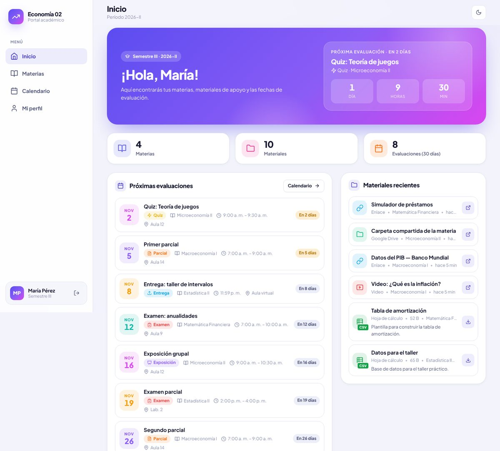
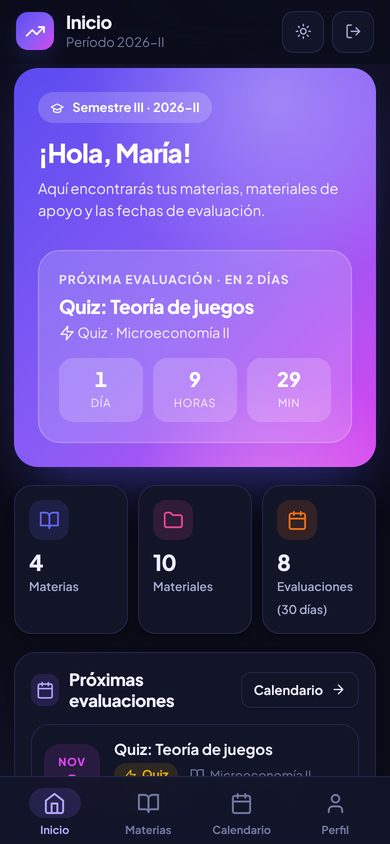
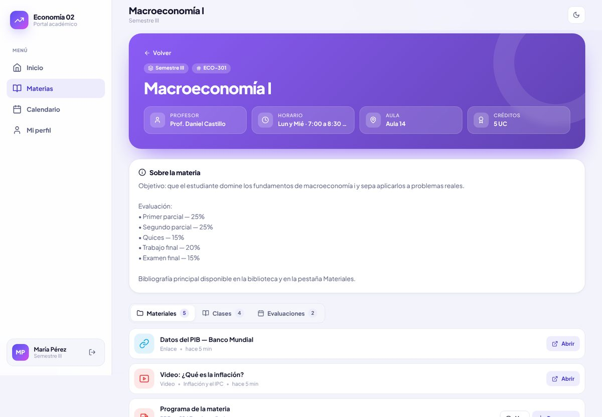
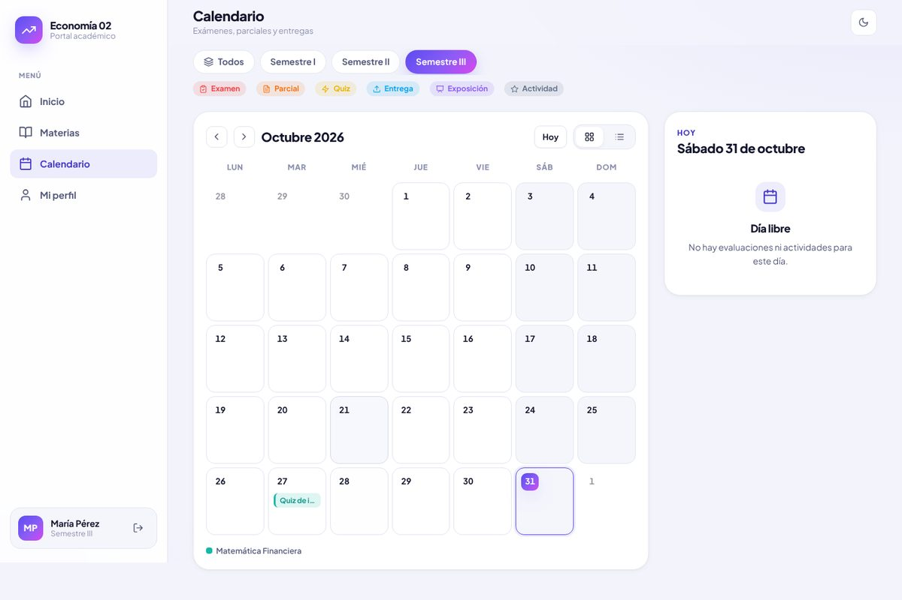
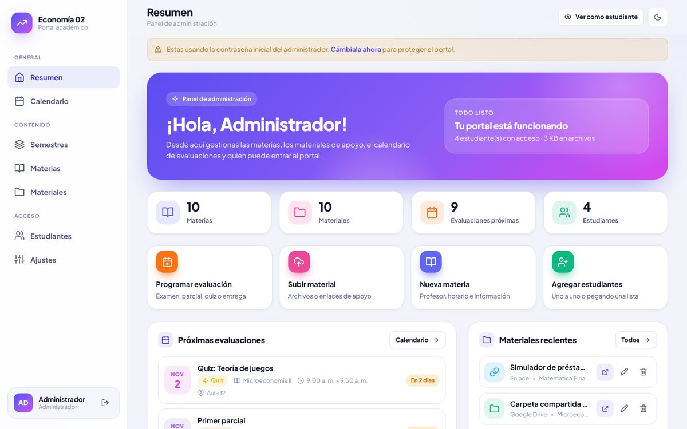
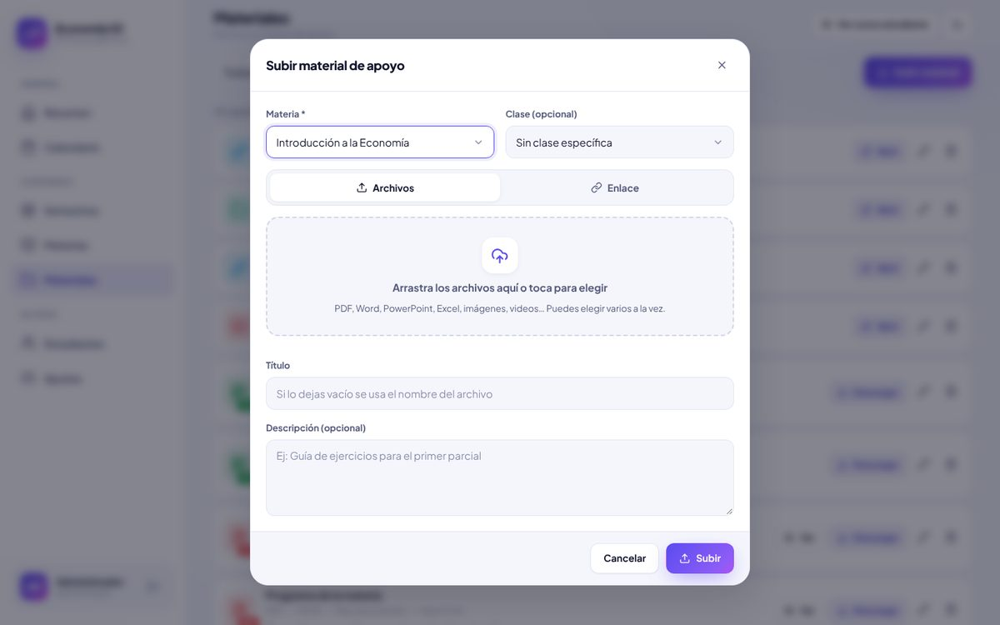
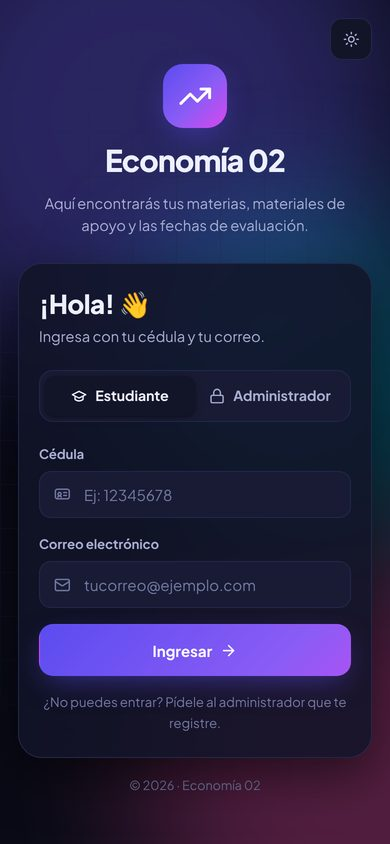
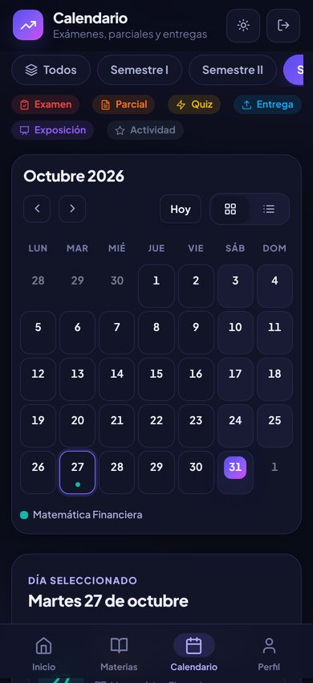
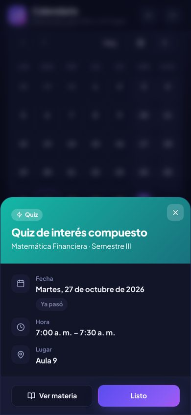

# Economía 02 · Portal académico

Portal web para la universidad donde los estudiantes entran con su **cédula y correo** y encuentran:

- 📚 **Materias por semestre**: profesor, horario, aula, créditos e información general de cada materia.
- 🧑‍🏫 **Clases**: el tema y contenido de cada clase, con sus archivos adjuntos.
- 📁 **Materiales de apoyo**: PDF, Word, PowerPoint, Excel, imágenes, videos y enlaces (YouTube, Drive…), para ver o descargar.
- 🗓️ **Calendario de evaluaciones**: exámenes, parciales, quices, entregas y exposiciones, con cuenta regresiva para la próxima.

Y un **panel de administración** exclusivo para ti, donde cargas todo: semestres, materias, clases, materiales, fechas del calendario y la lista de estudiantes que pueden entrar.

Funciona en **teléfono y computadora** (diseño adaptable, menú inferior en el móvil) y tiene **modo claro y oscuro**.

| Inicio del estudiante (PC) | Teléfono |
| --- | --- |
|  |  |

| Detalle de materia | Calendario |
| --- | --- |
|  |  |

| Panel de administración | Subir material |
| --- | --- |
|  |  |

| Login (móvil, modo oscuro) | Calendario (móvil) | Detalle de evaluación |
| --- | --- | --- |
|  |  |  |

---

## Cómo ponerlo a funcionar

Necesitas **Node.js 22.13 o superior** ([descargar](https://nodejs.org)). No hace falta instalar ninguna base de datos: usa SQLite, que viene incluido en Node.

```bash
npm install
```

```bash
npm start
```

Abre <http://localhost:3000>.

La primera vez se crea el administrador:

- **Usuario:** `admin`
- **Contraseña:** `admin123`

El panel te pedirá cambiarla en **Ajustes**. También puedes definirla antes de arrancar con las variables `ADMIN_USER` y `ADMIN_PASSWORD` (ver `.env.example`).

### ¿Quieres verlo con datos de ejemplo?

```bash
npm run demo
```

Carga 3 semestres con materias de Economía, clases, materiales, evaluaciones y estudiantes de prueba. Para entrar como estudiante usa la cédula **12345678** y el correo **estudiante@demo.com**. (Si ya tienes materias cargadas no hace nada; con `npm run demo -- --force` reemplaza todo el contenido por el de ejemplo).

---

## Cómo se usa

### Como administrador (tú)

Entra en la pestaña **Administrador** de la pantalla de inicio. En el **Resumen** verás una guía de primeros pasos:

1. **Semestres** → crea “Semestre I”, “Semestre II”…
2. **Materias** → agrega cada materia con su color, profesor, horario, aula, créditos e información (programa, bibliografía, forma de evaluación…). Los enlaces que escribas se vuelven clicables.
3. Dentro de cada materia:
   - **Clases**: registra el tema y contenido de cada clase.
   - **Materiales**: sube varios archivos a la vez (arrastrando o eligiendo) o pega enlaces. Puedes asociarlos a una clase.
   - **Evaluaciones**: programa exámenes, parciales, quices, entregas o exposiciones.
4. **Calendario** → vista mensual o de lista; toca un día para agregar una evaluación en esa fecha o toca una evaluación para editarla.
5. **Estudiantes** → agrégalos uno por uno o **pega la lista completa** desde Excel/Google Sheets (una línea por estudiante con cédula, correo y nombre, en cualquier orden).
6. **Ajustes** → nombre del portal, universidad, período, mensaje de bienvenida y tu usuario/contraseña.

Con el botón **“Ver como estudiante”** puedes revisar cómo se ve todo desde el lado del estudiante.

### Como estudiante

Entra con su **cédula** y el **correo** que tiene registrado. La cédula se puede escribir con o sin puntos, guiones o la letra V/E (`V-12.345.678` = `12345678`).

- **Inicio**: saludo, cuenta regresiva de la próxima evaluación, próximas fechas, materiales recientes y sus materias.
- **Materias**: filtradas por semestre y con buscador. Cada materia tiene sus pestañas de Materiales, Clases y Evaluaciones.
- **Calendario**: mensual o en lista, filtrable por semestre.
- **Perfil**: su nombre y el semestre que cursa (se usa para mostrarle primero lo suyo).

### Acceso restringido o abierto

Por defecto **solo entran los estudiantes que tú registres**. Si prefieres que cualquiera se registre solo con su cédula y correo, activa **Registro abierto** en Ajustes. Puedes desactivar el acceso de un estudiante en cualquier momento desde su ficha (su sesión se cierra al instante).

---

## Publicarlo en internet

Es una aplicación Node.js normal; sirve cualquier hosting que ejecute Node 22 y tenga un **disco persistente** para la carpeta de datos (base de datos + archivos subidos).

| Variable | Para qué sirve | Valor por defecto |
| --- | --- | --- |
| `PORT` | Puerto del servidor | `3000` |
| `DATA_DIR` | Carpeta de la base de datos y los archivos subidos | `./data` |
| `ADMIN_USER` / `ADMIN_PASSWORD` | Administrador que se crea la primera vez | `admin` / `admin123` |
| `MAX_UPLOAD_MB` | Tamaño máximo por archivo | `50` |
| `TRUST_PROXY` | Pon `1` si está detrás de un proxy (Render, Railway, Nginx…) | — |

**Con Docker:**

```bash
docker build -t portal-economia .
```

```bash
docker run -d -p 3000:3000 -v portal-datos:/data -e ADMIN_PASSWORD=tu-clave-segura -e TRUST_PROXY=1 portal-economia
```

**En Railway / Render / un VPS:** comando de inicio `npm start`, configura las variables de arriba y monta un volumen/disco en la ruta de `DATA_DIR` (por ejemplo `/data`). ⚠️ Sin disco persistente, los materiales y datos se borran cada vez que el servicio se reinicia.

**Copias de seguridad:** basta con copiar la carpeta `DATA_DIR` (contiene `portal.db` y `uploads/`).

---

## Seguridad

- La contraseña del administrador se guarda cifrada (scrypt) y las sesiones usan cookies `HttpOnly` / `SameSite`.
- Solo el administrador puede crear, editar o borrar contenido; los estudiantes únicamente leen y descargan.
- Los archivos solo se pueden descargar con una sesión iniciada.
- Hay un límite de intentos fallidos de inicio de sesión.
- **Importante:** la cédula y el correo no son secretos como una contraseña. Cualquiera que conozca la cédula y el correo de un estudiante registrado podría entrar como él. Para un portal de consulta de materiales suele ser suficiente, pero no publiques aquí información confidencial. Sirve el portal siempre con **HTTPS**.

---

## Para desarrolladores

```bash
npm run dev
```

```bash
npm test
```

```
server.js              Servidor Express, páginas y manejo de errores
src/db.js              Esquema SQLite y utilidades
src/auth.js            Contraseñas, sesiones y límite de intentos
src/routes/auth.js     Inicio/cierre de sesión
src/routes/portal.js   API de lectura (estudiantes y admin) y descarga de archivos
src/routes/admin.js    API de administración (CRUD, subidas, importación)
views/                 login.html, app.html (estudiante), admin.html (panel)
public/css/styles.css  Sistema de diseño (claro/oscuro, adaptable)
public/js/             common.js (componentes), student.js, admin.js, login.js
scripts/seed-demo.js   Datos de ejemplo
test/                  Pruebas de la API (node:test)
```

Sin compilación ni frameworks en el frontend: HTML, CSS y JavaScript puros. Dependencias del servidor: `express` y `multer`.
